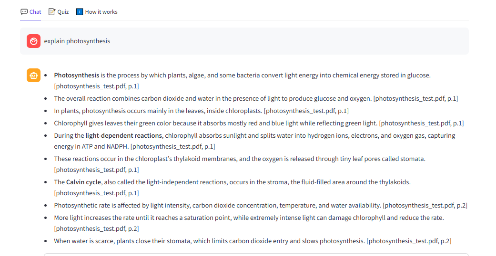
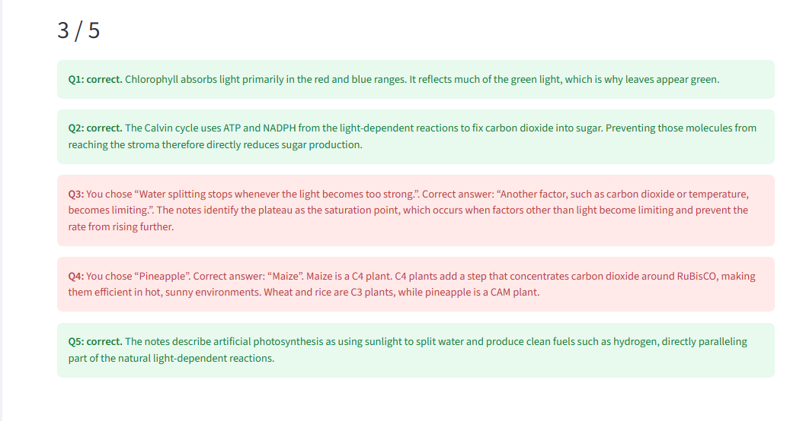
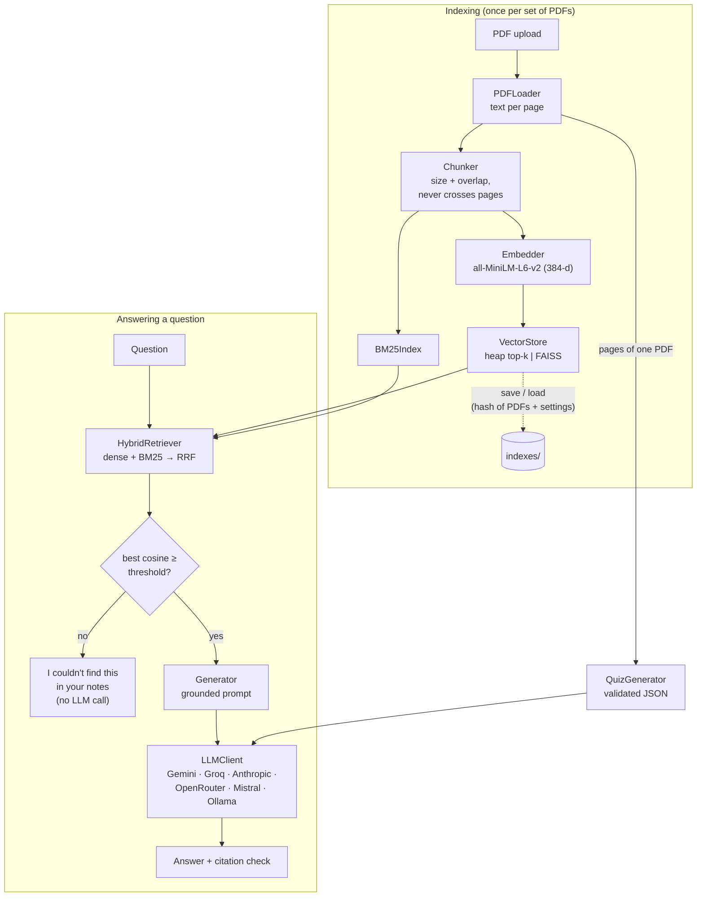
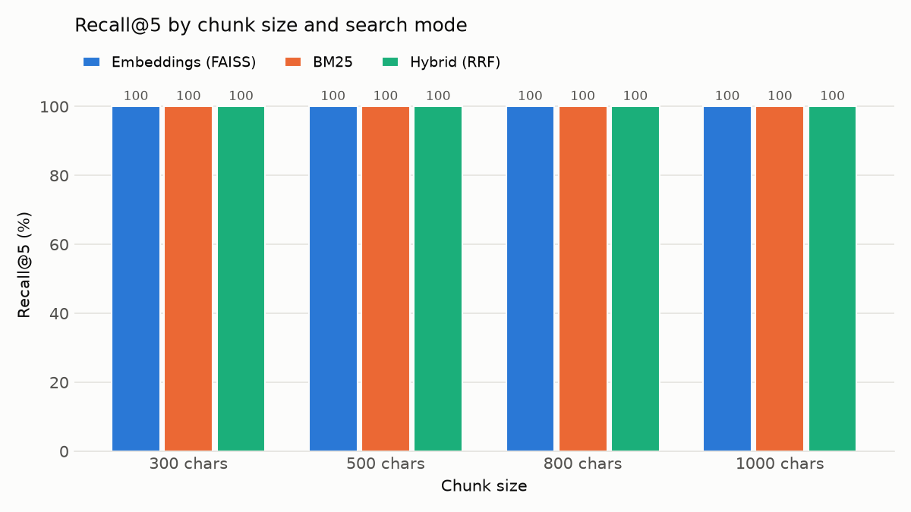
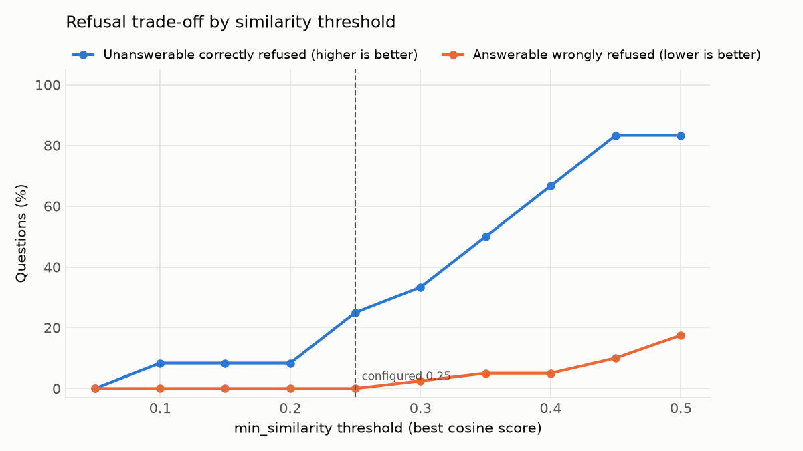

# NoteMind: chat with your university notes

[](https://github.com/abdullahqureshi6687-dotcom/notemind/actions/workflows/tests.yml)


Upload lecture PDFs, ask questions, and get answers **grounded only in your notes**, with a
citation such as `[lecture3.pdf, p.12]` after every claim. If the notes don't contain the
answer, NoteMind says *"I couldn't find this in your notes."* instead of guessing. It also
writes multiple-choice quizzes from any page range, and ships with a measured evaluation of
its retrieval quality.

The whole retrieval pipeline is written from scratch, without LangChain or LlamaIndex:
page-aware PDF ingestion, chunking, a hand-written heap top-k search, FAISS, BM25, and hybrid
search with Reciprocal Rank Fusion.

**Live demo:** https://notemind-app.streamlit.app/ · **Deployment guide:** [DEPLOYMENT.md](DEPLOYMENT.md)




---

## The problem

Students keep hundreds of pages of slides and handouts. General chatbots answer from the
internet, not from *your* course, and they invent page numbers. NoteMind answers only from
the PDFs you upload, shows exactly which page each fact came from, and refuses when the notes
don't cover the question.

## Features

- **Page-aware PDF ingestion.** Text is extracted page by page, so every answer can cite the
  exact page. Scanned (image-only) PDFs, empty pages and files that are not real PDFs get clear
  warnings instead of silent failures.
- **Configurable chunking** (size and overlap), with chunks that never cross a page boundary.
- **Four retrieval modes**, switchable in the UI:
  - `heap`: cosine similarity with a **hand-written binary min-heap**, O(n log k)
  - `faiss`: the same exact search via FAISS `IndexFlatIP`
  - `bm25`: keyword search (rank-bm25) with an inverted index
  - `hybrid`: dense + BM25 fused with **Reciprocal Rank Fusion**
- **Two-layer refusal.** A cosine-similarity threshold refuses obviously off-topic questions
  *without calling the LLM*; the prompt makes the model refuse when the retrieved context is
  insufficient.
- **Citation checking.** Every `[file, p.X]` in an answer is verified against the chunks that
  were actually retrieved; invented citations are flagged in the UI.
- **Quiz generator** with Pydantic-validated JSON, one automatic repair attempt, a bigger
  token budget when output is truncated, and shuffled options.
- **Six LLM providers behind one interface:** Gemini, Groq and Anthropic via their SDKs, plus
  OpenRouter, Mistral and local Ollama through one OpenAI-compatible client. Retries with
  exponential backoff, `Retry-After` support, and an early stop when a daily quota is exhausted.
- **Bring your own key** in the UI (kept in session memory only), so a public demo keeps
  working when the shared free quota runs out.
- **Caching:** the embedding model loads once per server (`st.cache_resource`); indexes are
  saved to disk under a content hash of the PDFs and settings, so re-uploading the same notes
  loads in milliseconds.
- **Evaluation script** reporting Recall@k and MRR with bootstrap confidence intervals,
  a refusal-threshold sweep, an optional full-pipeline LLM evaluation, and charts.
- **202 offline tests** (pytest, about 6 seconds), run on every push by GitHub Actions.

## Architecture



`RAGPipeline` wires these components together and is the only object the Streamlit app and the
evaluation script talk to.

### Design decisions

| Decision | Why |
|---|---|
| Chunks never cross page boundaries | A chunk belongs to exactly one page, so citations are exact by construction instead of being guessed by the LLM. |
| Heap top-k **and** FAISS | The heap shows the algorithm (O(n log k) time, O(k) memory) and serves as a reference implementation; tests check that it returns exactly what FAISS returns. FAISS is the fast path. |
| Hybrid search fuses **ranks** (RRF), not scores | Cosine and BM25 scores live on different scales; adding them lets one retriever dominate. RRF only needs ranks. |
| Refusal threshold on the best cosine score | Cheap and deterministic, saves an LLM call for clearly off-topic questions. Tuned to wrongly refuse **no** answerable question, because a wrong refusal hides an answer the LLM never sees. |
| One `LLMClient` interface (Strategy pattern) | Switching provider is a one-line config change; the generator and quiz code never import an SDK. |
| Frozen config dataclasses, validated on load | Two browser sessions can't change each other's settings; typos and duplicate keys in `config.yaml` fail loudly. |
| Dependency injection for embedder and LLM | Tests use a hashing encoder and a scripted fake LLM, so all 202 tests run offline in seconds. |

## Tech stack

Python 3.12 · sentence-transformers (`all-MiniLM-L6-v2`, CPU) · FAISS · rank-bm25 · pypdf ·
Pydantic · Streamlit · pytest · GitHub Actions · Docker

## Setup (Windows)

Requires Python 3.12 and Git. No GPU needed.

```powershell
git clone https://github.com/abdullahqureshi6687-dotcom/notemind.git
cd notemind
py -3.12 -m venv venv
venv\Scripts\Activate.ps1          # cmd.exe: venv\Scripts\activate
python -m pip install --upgrade pip
pip install -r requirements-dev.txt
pip install -e .
copy .env.example .env
```

Open `.env` and add a key for **one** provider, then set the same provider in `config.yaml`
(`generation.provider`):

| Provider | Free option | Key variable |
|---|---|---|
| `gemini` | Google AI Studio free tier (small daily quota) | `GEMINI_API_KEY` |
| `openrouter` | models whose ID ends in `:free` | `OPENROUTER_API_KEY` |
| `groq` | free tier | `GROQ_API_KEY` |
| `mistral` | free "Experiment" plan | `MISTRAL_API_KEY` |
| `ollama` | runs locally, no key | none |
| `anthropic` | paid | `ANTHROPIC_API_KEY` |

Check the connection:

```powershell
python -m notemind.llm_client
```

Troubleshooting: if `import torch` fails with `WinError 126`, install the latest
[Microsoft Visual C++ Redistributable (x64)](https://aka.ms/vc14/vc_redist.x64.exe) and restart
the terminal.

## Usage

```powershell
streamlit run app/streamlit_app.py --server.address localhost
```

Upload PDFs in the sidebar (or click **Try demo notes**), ask questions in the **Chat** tab,
expand **Sources** under an answer, and generate a quiz in the **Quiz** tab. Settings (chunk
size, overlap, search mode, top-k, refusal threshold, provider, your own API key) are in the
sidebar.

Developer commands:

```powershell
python -m notemind.pdf_loader data\sample_pdfs\lecture1.pdf   # pages, warnings, first chunks
python -m notemind.hybrid "what is a heap?"                   # compare all four search modes
python -m notemind.generator "what is a heap?"                # cited answer from the CLI
python -m notemind.quiz assets\demo\dsa_demo_notes.pdf 5      # 5-question quiz
python eval/run_eval.py                                       # retrieval evaluation (no API calls)
python eval/run_eval.py --with-llm --llm-sample 40            # + full pipeline with the LLM
python -m pytest                                              # 202 tests
```

## Evaluation

`eval/eval_set.json` holds **52 hand-labelled questions** about the two demo PDFs in
`assets/demo/` (18 pages of original lecture notes written for this project):

- **40 answerable** questions, each labelled with the page(s) that answer it. They are
  paraphrased rather than copied, so keyword search gets no unfair advantage.
- **12 unanswerable** questions, 7 of them deliberate near-misses (for example Q-learning,
  when the notes only mention reinforcement learning in general).

Metrics: **Recall@k** (a relevant page is in the top k) and **MRR** (mean reciprocal rank of
the first relevant page), with 95% bootstrap confidence intervals. Full report:
[`eval/results/results.md`](eval/results/results.md).

### Retrieval (40 answerable questions)

| Chunk size | Mode | Recall@1 | Recall@3 | Recall@5 | MRR |
|---|---|---|---|---|---|
| 300 | Embeddings (FAISS) | 97.5% | 100% | 100% | 0.988 |
| 300 | BM25 | 92.5% | 100% | 100% | 0.963 |
| 300 | Hybrid (RRF) | 97.5% | 100% | 100% | 0.983 |
| 500 | Embeddings (FAISS) | 100% | 100% | 100% | 1.000 |
| 500 | BM25 | 95.0% | 100% | 100% | 0.971 |
| 500 | Hybrid (RRF) | 97.5% | 100% | 100% | 0.983 |
| **800 (default)** | Embeddings (FAISS) | 97.5% | 100% | 100% | 0.988 |
| **800 (default)** | BM25 | 97.5% | 100% | 100% | 0.988 |
| **800 (default)** | Hybrid (RRF) | 97.5% | 100% | 100% | 0.988 |
| 1000 | Embeddings (FAISS) | 97.5% | 100% | 100% | 0.988 |
| 1000 | BM25 | 100% | 100% | 100% | 1.000 |
| 1000 | Hybrid (RRF) | 97.5% | 100% | 100% | 0.988 |

Median retrieval latency is about 14 ms per question on a laptop CPU, including embedding the
question.

**How to read this honestly.** Every configuration finds a correct page in the top 3 for
all 40 questions, and the confidence intervals of all methods overlap. The pipeline works,
but this benchmark is **too easy to rank the methods**: each demo page covers one distinct
topic, so retrieval is rarely confused. Claims such as "hybrid beats BM25" are not supported
by this data. A harder benchmark, with real course notes where topics overlap across pages
and files, is the main item under future work.



### Refusal threshold (12 unanswerable vs 40 answerable questions)

| Threshold (best cosine) | Unanswerable correctly refused | Answerable wrongly refused |
|---|---|---|
| 0.20 | 8.3% | 0.0% |
| **0.25 (configured)** | **25.0%** | **0.0%** |
| 0.30 | 33.3% | 2.5% |
| 0.40 | 66.7% | 5.0% |
| 0.50 | 83.3% | 17.5% |

The threshold is set to **0.25**, the highest value that wrongly refuses no answerable
question. Higher thresholds catch more off-topic questions, but each wrong refusal hides an
answer the LLM never gets to see, while an off-topic question that passes the threshold can
still be refused by the LLM. So the threshold is a cheap first filter, and the prompt-level
refusal is the second line of defence.



### Full pipeline with an LLM

_Fill in after running `python eval/run_eval.py --with-llm` (provider and model: ______)._

| Metric | Value |
|---|---|
| Unanswerable questions refused (threshold + LLM) | __% |
| Answerable questions wrongly refused | __% |
| Answers citing an expected page | __% |
| Answers with an invented citation | __% |

## Project structure

```
notemind/
├── src/notemind/
│   ├── config.py        # validated config dataclasses, env overrides, API keys
│   ├── models.py        # Page, Chunk, SearchResult, Answer
│   ├── pdf_loader.py    # PDFLoader
│   ├── chunker.py       # Chunker
│   ├── heap_topk.py     # hand-written MinHeap, top_k, cosine_top_k
│   ├── embedder.py      # Embedder (sentence-transformers)
│   ├── vector_store.py  # VectorStore: heap + FAISS, save/load
│   ├── bm25_index.py    # BM25Index
│   ├── hybrid.py        # HybridRetriever + reciprocal rank fusion
│   ├── llm_client.py    # LLMClient interface, 6 providers, retries
│   ├── prompts.py       # prompt templates
│   ├── generator.py     # Generator + citation checking
│   ├── quiz.py          # QuizGenerator + Pydantic schema
│   └── pipeline.py      # RAGPipeline
├── app/streamlit_app.py # UI (and app/requirements.txt for Streamlit Cloud)
├── eval/                # eval_set.json, run_eval.py, results/
├── tests/               # 202 offline tests
├── assets/demo/         # demo lecture notes (original, safe to publish)
├── notebooks/           # retrieval experiments + heap vs FAISS benchmark
├── config.yaml          # all settings
├── Dockerfile           # container image (Hugging Face Spaces / any Docker host)
└── DEPLOYMENT.md
```

## Limitations

- **The benchmark saturates.** On 18 single-topic pages every method scores 100% Recall@3,
  so the evaluation can't separate the retrievers.
- **No OCR.** Scanned or image-only pages are detected and reported, but can't be searched.
- **Character-based chunking.** Chunks don't follow headings or slides, and a sentence split
  across two pages lands in two chunks.
- **The embedding model reads ~256 tokens per chunk.** Text beyond that is not embedded
  (the config warns about chunk sizes over ~1,000 characters).
- **English-tuned models.** Retrieval quality on other languages is untested.
- **The refusal threshold is corpus-dependent.** It was tuned on the same 52 questions it is
  reported on; it should be re-checked on each new set of notes.
- **Free LLM tiers are small and unreliable.** Daily quotas and shared free pools can fail;
  the app reports this clearly and supports bring-your-own-key.
- **Privacy.** Retrieved note text is sent to the chosen LLM provider (except with Ollama).

## Future work

- A harder evaluation set built from real course notes with overlapping topics, plus a held-out
  split for tuning the threshold.
- Structure-aware chunking (headings, slide titles) and a cross-encoder re-ranker.
- OCR for scanned pages (e.g. Tesseract).
- Answer-quality evaluation (faithfulness, LLM-as-judge with spot checks).
- Streaming answers and multi-turn follow-up questions.
- Approximate nearest-neighbour indexes (FAISS IVF/HNSW) for very large note collections.

## Acknowledgements

[sentence-transformers](https://www.sbert.net/) · [FAISS](https://github.com/facebookresearch/faiss) ·
[rank-bm25](https://github.com/dorianbrown/rank_bm25) · [Streamlit](https://streamlit.io/) ·
Reciprocal Rank Fusion: Cormack, Clarke & Büttcher (SIGIR 2009).
